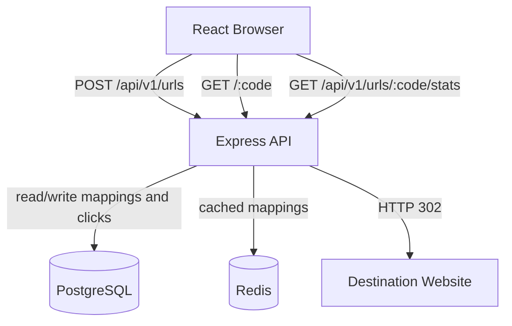

# LinkScale — Scalable URL Shortener POC

A GitHub-ready, full-stack system design fundamentals project using **React, Express, PostgreSQL, Redis, Docker Compose, and Node's built-in test runner**.

## Features
- Create short URLs with cryptographically random Nano ID codes
- Redirect short links using a Redis cache-aside strategy
- Track redirect clicks in PostgreSQL
- Look up link analytics
- Validate HTTP(S) URLs, use parameterized SQL, and rate-limit link creation
- Responsive React dashboard
- Dockerized local development and backend tests

## Quick start

**Prerequisites:** Docker Engine/Desktop with Docker Compose.

```bash
docker compose up --build
```

Open **http://localhost:5173** for the UI. API: **http://localhost:3000**. Health: **http://localhost:3000/health**.

First build may take several minutes. PostgreSQL is initialized automatically on a fresh Docker volume. Stop with `docker compose down`; reset stored links with `docker compose down -v` (destructive).

### Try the API

```bash
curl -X POST http://localhost:3000/api/v1/urls \
  -H 'Content-Type: application/json' \
  -d '{"originalUrl":"https://example.com/products/123"}'
# Copy shortCode from the response:
curl -i http://localhost:3000/<shortCode>
curl http://localhost:3000/api/v1/urls/<shortCode>/stats
```

### Run tests

```bash
cd backend
npm install
npm test
```

The tests cover URL/code validation and a mocked end-to-end HTTP create → redirect → stats flow. Database/Redis integration and performance tests are suggested next steps, not claimed as included.

### Develop without Docker for frontend

```bash
cd frontend
npm install
npm run dev
```

Keep the backend running at localhost:3000. Set `VITE_API_URL` at frontend build time to use a different API address. Docker frontend build uses localhost:3000 by default, which is correct when opened in a browser on the same host.

## Architecture



See [docs/system-design.md](docs/system-design.md) for HLD, LLD, capacity assumptions, trade-offs, and production considerations; [docs/api.md](docs/api.md) for endpoint details.

## Security and limitations

This is an educational POC, **not production-ready**. URL creation accepts arbitrary public HTTP(S) destinations, which could be abused for phishing. URL validation blocks some local/private hosts but is **not a complete SSRF defense** (e.g. IPv6, DNS rebinding, encoded hosts). The service does not fetch destinations, but deployers should still implement abuse detection, reporting, blocklists, domain reputation, and stricter URL policies. Redis is a performance cache; PostgreSQL is authoritative. Redirect counts are synchronous and add database write latency. No authentication, expiry, custom domains, distributed rate limits, or audit logging is implemented.

## License

MIT — see [LICENSE](LICENSE).
